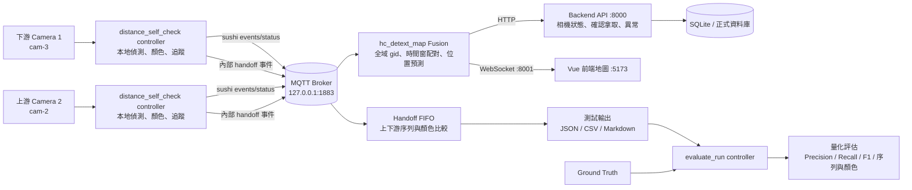
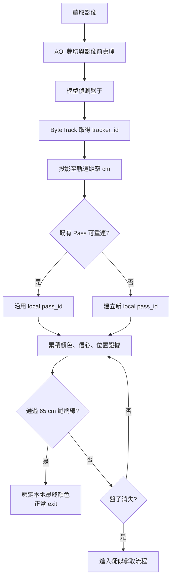
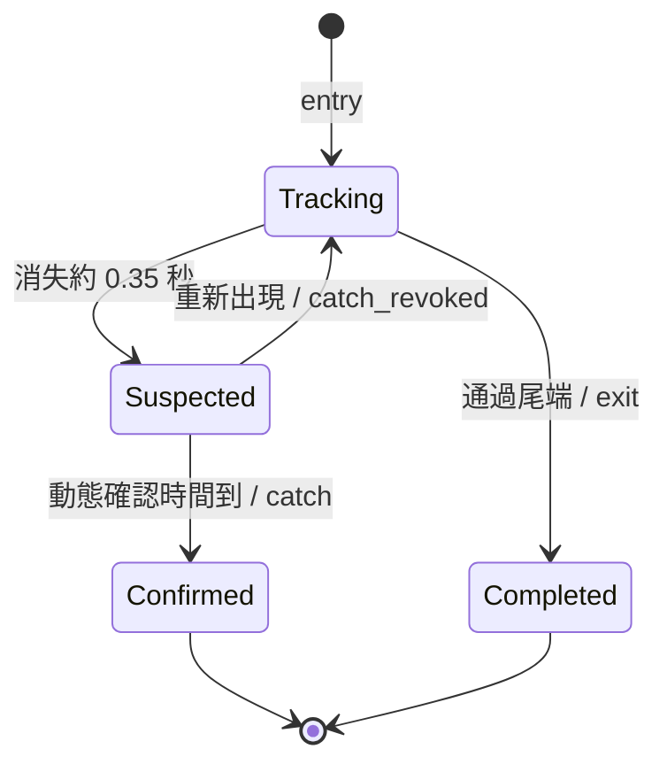
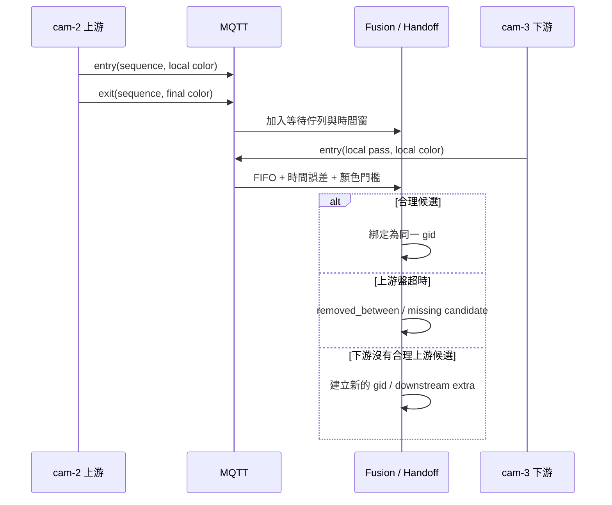
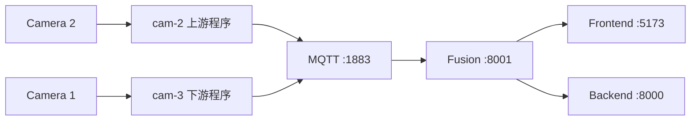

# 盤子跨鏡頭辨識與即時地圖系統架構

版本：2026-11-11  
目前測試拓樸：`cam-2 → cam-3`  
實體配置：Camera 2 為上游 `cam-2`，Camera 1 為下游 `cam-3`

## 1. 系統目標

本系統要在輸送帶持續運轉、盤子密集出現的情況下完成：

1. 每台鏡頭獨立偵測盤子與顏色。
2. 在單一鏡頭內維持穩定的盤子生命週期。
3. 將同一盤跨鏡頭配對，避免漏盤後造成後續序列整體位移。
4. 即時區分正常離開、疑似拿取、撤銷疑似與確認拿取。
5. 讓前端同時顯示多盤的位置與狀態。
6. 保存原始證據、演算法結果與 Ground Truth，供後續量化改善。

## 2. 整體架構



## 3. 元件責任

| 元件 | 主要責任 | 產出 |
|---|---|---|
| `app/controllers/distance_self_check.py` | 影像推論、顏色標準化、距離估算、單鏡頭 Pass、斷軌重連、拿取初判 | 本地生命週期與觀測資料 |
| `handoff.py` | MQTT 雙協定發布、上下游 FIFO、顏色比較、疑似／撤銷／確認事件 | MQTT 事件與 handoff 結果 |
| MQTT Broker | 在辨識端、Fusion 與其他服務間傳遞事件 | QoS 1 訊息、retained 狀態 |
| Fusion Engine | 建立全域 `gid`、跨鏡頭配對、多盤位置預測、確認拿取 | 即時盤子清單與位置 |
| Frontend | WebSocket 即時地圖、多盤動畫、重疊展開、疑似拿取提示 | 操作畫面 |
| Backend | 保存確認事件、相機狀態與營運資料 | API 與持久化資料 |
| `app/controllers/evaluate_run.py` | 將程式結果與人工提供的 Ground Truth 分開比較 | 可重播的量化評估 |

## 4. 單鏡頭辨識流程



### 4.1 顏色處理

- 每台鏡頭獨立保存本地顏色，禁止用另一台鏡頭的顏色覆蓋。
- 顏色穩定條件目前為：至少 2 票、一致比例至少 75%、用於投票的信心至少 0.85。
- 現場操作色將原始 `gray` 標準化為 `light_green`，原始值仍保留在資料中。
- 下游只有在本地顏色穩定後才發布 `entry`，避免前端先收到 `unknown` 而顯示灰色。

### 4.2 追蹤中斷重連

Tracker 重新出現時，系統使用以下條件判斷是否屬於原盤：

- 消失時間不超過 3.5 秒。
- 距離不可明顯逆向，允許最多 3 cm 誤差。
- 與速度預測位置的誤差不超過 15 cm。
- 已有穩定顏色時，不允許不同顏色接管原 Pass。
- 短時間內使用 Bounding Box 位移門檻阻止相鄰盤互換身分。

## 5. MQTT 架構

系統同時發布兩組 MQTT 資料，目的不同。

### 5.1 內部診斷與上下游 Handoff

```text
plate-self-check/handoff/v1/event/<camera_id>
plate-self-check/handoff/v1/status/<camera_id>
```

主要事件包含 `plate_detected`、`plate_updated`、`plate_final`、`plate_removed`、`plate_claimed` 與 `downstream_result`。這組資料保存較完整的 Pass、序號、顏色、時間與配對證據。

### 5.2 hc_detext_map 即時事件

```text
sushi/events/<camera_id>
sushi/status/<camera_id>
```

事件生命週期：

| 事件 | 意義 | 是否最終結果 |
|---|---|---:|
| `entry` | 盤子已在此鏡頭建立穩定本地身分 | 否 |
| `exit` | 盤子正常通過鏡頭尾端 | 是 |
| `catch_suspected` | 盤子短暫消失，疑似被拿走 | 否 |
| `catch_revoked` | 疑似盤重新出現，撤銷通知 | 否 |
| `catch` | 已確認在此鏡頭區域內拿走 | 是 |

`catch_suspected`、`catch_revoked` 與最後的 `catch` 共用同一個 `event_id`，避免前端或計價端將同一次拿取重複計算。

## 6. 即時拿取判斷



目前動態確認時間：

```text
remaining_cm = 65 cm - 最後位置
dynamic_timeout = clamp((remaining_cm / 10 cm/s) × 0.35, 0.65 s, 1.50 s)
```

實務效果：

- 約 0.35 秒即可在前端顯示疑似拿取。
- 確認不再固定等待 3.5 秒，可在下一盤進入前完成多數判斷。
- 每盤各自保存狀態與計時器，多盤同時出現時不互相阻塞。
- 盤子若只是遮擋或短暫漏檢，重新出現後會撤銷疑似事件。

## 7. 跨鏡頭配對

目前正式測試使用 FIFO，配對依據為：

1. 輸送帶先後順序。
2. 上下游事件的區段通行時間窗。
3. 顏色硬門檻與顏色一致性檢查。
4. 每台鏡頭自己的 local pass ID。



時間窗外的舊同色盤不會直接消耗下一盤，目的是避免一盤漏檢後讓後續顏色全部錯位。

## 8. Fusion 與多盤動畫

Fusion 對每個盤子建立獨立全域 `gid`，並保存：

- 各鏡頭的 `(camera_id, plate_id)` 綁定。
- 盤子類別與 UI 顏色。
- 目前軌道位置 `s`。
- `tracked`、`predicted`、`suspected`、`lost` 狀態。
- 每個區段的起點、終點、開始時間與預估通行時間。

區段時間由成功配對樣本持續學習，中位數用來降低單次異常值影響。前端收到完整 `plates[]` 清單後，以 `gid` 為動畫鍵值；位置非常接近時會將盤子視覺展開，避免多盤完全重疊而看起來只有一盤。疑似拿取盤使用紅色外框提示。

地圖像素、路徑或鏡頭配置熱更新時，Fusion 會保留現有盤子的
`gid`、鏡頭綁定、等待配對佇列、Checkpoint 紀錄及已學習的區段通行時間。
前端將背景、軌道與鏡頭快取為靜態圖層，動畫期間只重畫盤子；高像素畫布會降低
重畫頻率，避免解析度增加後造成主執行緒長時間占用。

## 9. 資料與評估架構

每次鏡頭執行建立獨立輸出資料夾。主要產物：

| 檔案 | 用途 |
|---|---|
| `distance_detections.csv` | 每幀距離、顏色、信心與 Pass |
| `color_calibration.csv` | 原始顏色特徵與校正資料 |
| `upstream_lifecycle.csv` | 上游盤子生命週期 |
| `downstream_color_events.csv` | 下游本地顏色事件 |
| `mqtt_events.jsonl` | MQTT 發送與接收的完整證據 |
| `handoff_results.csv` | 上下游配對與拿取結果 |
| `handoff_summary.json` | 結構化統計結果 |
| `analysis_summary.md` | 從結構化資料產生的檢視報告 |

Ground Truth 由測試人員獨立提供，`app.controllers.evaluate_run` 產生：

- `ground_truth.json`
- `evaluation.json`
- `evaluation_summary.md`

主要指標包含 Removal Precision、Recall、F1、位置正確率、序號誤差、顏色正確率、盤數誤差、覆蓋率及疑似事件撤銷率。

## 10. 執行拓樸



目前兩支鏡頭命令：

```powershell
python main.py --camera 2 --handoff-role upstream --camera-id cam-2 --peer-camera-id cam-3 --mqtt-host 127.0.0.1 --mqtt-port 1883 --continuous-handoff --autosave-seconds 5 --matching-mode fifo

python main.py --camera 1 --handoff-role downstream --camera-id cam-3 --peer-camera-id cam-2 --mqtt-host 127.0.0.1 --mqtt-port 1883 --continuous-handoff --autosave-seconds 5 --matching-mode fifo
```

## 11. 目前限制與改善方向

1. 拿取仍是依盤子消失、最後位置與後續事件推論，尚未直接辨識手部拿取動作。
2. 動態逾時目前使用固定基準速度 10 cm/s，後續應改用每盤即時速度與區段學習速度。
3. 顏色相同且距離非常接近時，仍需要更多特徵，例如盤面外觀 embedding 或實體標記，才能提高身分可辨識性。
4. 前端重疊展開解決可視性，並不代表盤子的物理位置已被精確分離。
5. 新的疑似／撤銷／確認流程需以真實拿取測試量化通知延遲、誤報率與撤銷率。
6. 系統要擴充至多台鏡頭時，應以明確的有向拓樸 `cam-A → cam-B → cam-C` 建立每一條相鄰邊的獨立通行時間模型。

## 12. 驗收重點

後續每次演算法修改至少檢查：

- 多盤是否都有獨立 `gid`，前端數量是否與 Fusion snapshot 一致。
- 漏掉一盤後，下一盤是否仍配到正確身分與顏色。
- 疑似拿取是否在目標延遲內發出。
- 遮擋後重新出現是否正確撤銷。
- 確認拿取是否只有一筆，且位置與盤子序號正確。
- 上下游本地顏色是否保持獨立。
- Ground Truth 的 TP、FP、FN、位置、序號與顏色是否全部可追溯到原始事件。
